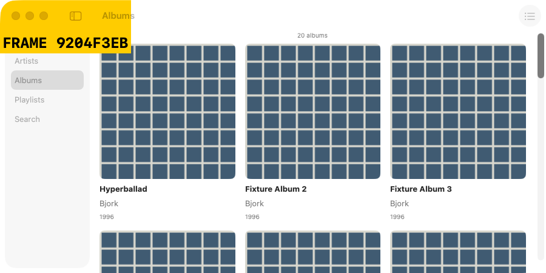
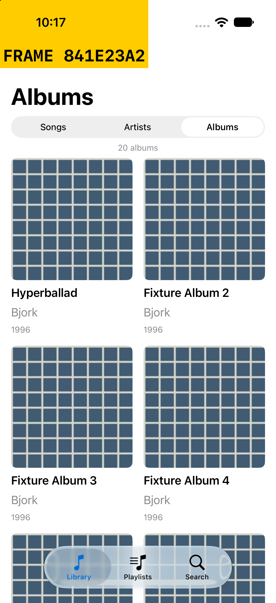
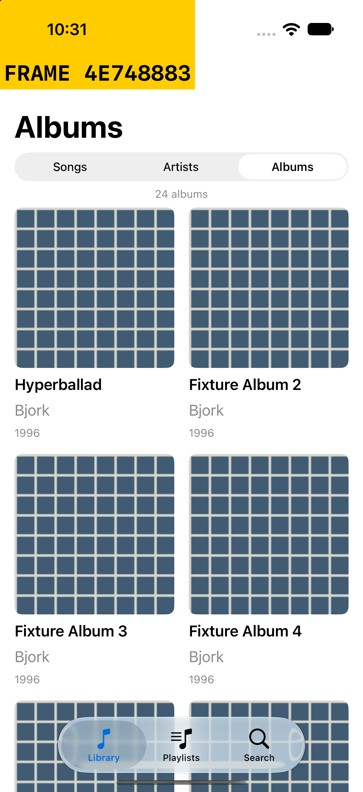
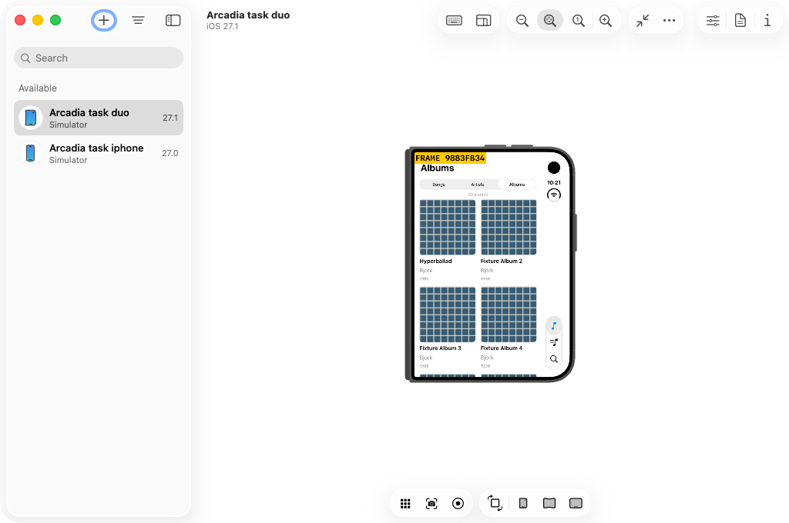

# Item count evidence — issue 27

The deterministic two-page fixture contains 24 albums. Before the change, the
initial page header reports only the 20 loaded albums. After the change it reports
24 without scrolling or fetching the remaining page.

| Layout | Before | After |
| --- | --- | --- |
| Mac |  |  |
| iPhone |  |  |
| Duo |  |  |

Images are unmodified native-loop captures inside disposable task
`issue-27-counts-1025` on `paseo-host`, with no host viewer. The adjacent JSON
receipts record source SHA, run ID, image SHA, actual simulator identity and capture
method. The yellow marker proves a current frame; it is Debug capture instrumentation.
Duo uses the genuine iOS 27.1 Duo simulator in its initial folded layout; its capture
includes the guest simulator window because direct display capture was unavailable.
These images support visual review, not behavioral correctness.

The exact regression `FeedbackLoopTests/testInitialPageCountIncludesUnloadedAlbums`
fails on the archived old implementation with `20 albums` instead of `24 albums`,
and passes on the fixed implementation before the last album has loaded. The old
snapshot adds only that test and the formatter compatibility key needed by Xcode
27.1; it does not change app behavior. Adjacent regression summaries retain the
failure and the seven passing focused tests.

Behavioral results and archive/cleanup details are recorded in the linked PR.

## Existing broader fixture failures

The expanded 20-test fixture UI run has 16 passes and four failures. All four
also fail on the archived old implementation in the same VM; their assertions
and app behavior are outside this count fix:

- `PlaylistSearchTests/testExplicitNextSupersedesPendingPlaylistPreparation`
- `PlaylistSearchTests/testNoMatchesAreHonestInEveryCategory`
- `SearchDiscoveryTests/testEmptyCategoryShowsPendingSearchAndPreservesSelectionForNewQuery`
- `SongArtistBrowseTests/testSongsLeadAndArtistNavigationPreservesPlayback`

The adjacent fixed/baseline fixture summaries retain the results. No failure was
hidden by changing these assertions. The default suite passed 46 tests with five
existing opt-in integration/review skips.
